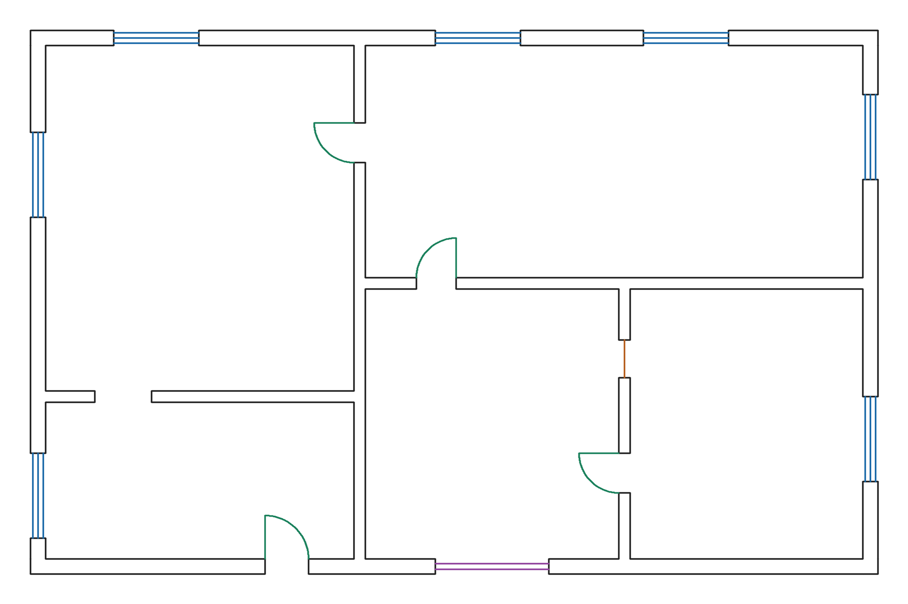
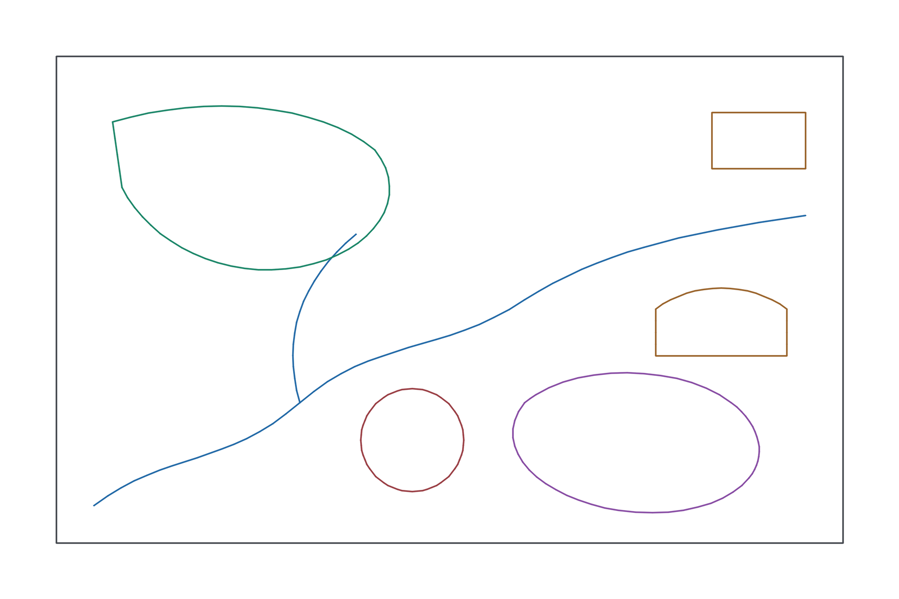
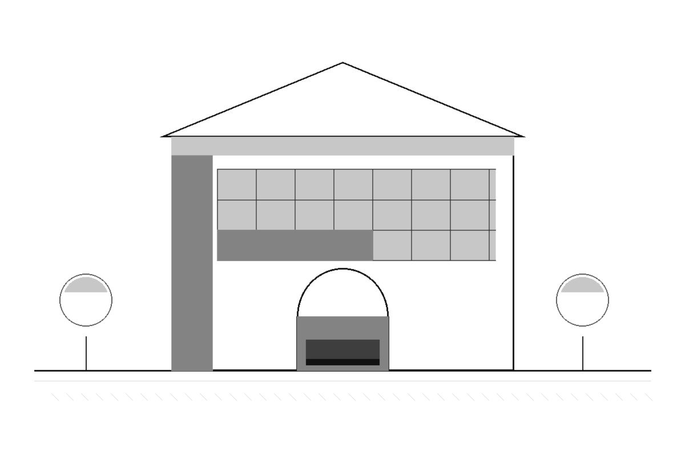

# 图片转 CAD Skill · Image-to-CAD Skill

把建筑平面、景观平面和透视钢笔画转换成分层 DXF。平面路线由助手读图整理布局，程序据此绘制可编辑图形；透视路线保留已确认钢笔稿的笔触与层次。

Convert architectural plans, landscape plans, and approved perspective pen drawings into
layered DXF. Plan routes draw editable geometry from a layout interpreted by the agent.
The perspective route preserves the strokes and tones of a pen drawing the user approved.



[Skill 说明](skills/image-to-cad/SKILL.md) · [中文运行说明](skills/image-to-cad/references/runtime.md) ·
[English runtime guide](skills/image-to-cad/references/runtime.en.md) ·
[第三方许可](THIRD-PARTY-NOTICES.md)

| 路线 / Route | 输入 / Input | 主要输出 / Main outputs |
| --- | --- | --- |
| 建筑平面<br>Architectural plan | 原图与墙体、开口布局 JSON<br>Source image and a full-image layout JSON | 分层 DXF、门窗图块、单画布叠合页<br>Layered DXF, door and window blocks, review page |
| 景观平面<br>Landscape plan | 原图与分层路径 JSON<br>Source image and layered paths in JSON | 分层 DXF、样条与多段线、叠合页<br>Layered DXF with splines and polylines, review page |
| 透视钢笔稿<br>Perspective pen drawing | 已确认的白底扫描稿或渲染稿<br>Approved pen drawing on a white background | 四档灰度实心 HATCH 的 DXF、SVG、PNG<br>DXF with four-tone solid HATCH, SVG, PNG |

## 示例 / Examples

三张图由 `examples/demo.py` 从本仓库自带的合成布局生成，可随时重跑。它们验证导出链路，
不是真实项目图纸。

The three images are generated by `examples/demo.py` from the synthetic layouts shipped in
this repository. They exercise the export pipeline; they are not real project drawings.

| 建筑平面 / Plan | 景观平面 / Landscape | 透视钢笔稿 / Pen |
| --- | --- | --- |
|  |  |  |
| 墙体并集、开口切割、门窗图块<br>`examples/apartment.json` | 七个景观图层、曲线与多段线<br>`examples/garden.json` | 四档灰度 HATCH、保留留白<br>钢笔稿由脚本合成 |

## 安装 / Installation

使用 Python 3.11，在仓库根目录执行。最后一条命令用合成图验证三条导出路线，第二条命令重新生成上面的示例图。

Run these from the repository root with Python 3.11. The last command checks all three
exporters; the second one regenerates the example images above.

```bash
python3.11 -m venv .venv
.venv/bin/python -m pip install -r skills/image-to-cad/requirements.txt
.venv/bin/python -m pip check
.venv/bin/python examples/smoke.py
.venv/bin/python examples/demo.py
```

Windows 使用 `.venv\Scripts\python.exe`。依赖版本固定，`pip check` 应无冲突。

## 加载 Skill / Load the skill

将整个 `skills/image-to-cad/` 文件夹交给能读取文件并运行 Python 的 Agent，它自带转换脚本和依赖清单。
Codex 用户可以从仓库根目录创建项目级链接后调用 `$image-to-cad`；也可以直接让 Agent 阅读
[SKILL.md](skills/image-to-cad/SKILL.md)。

Give the `skills/image-to-cad/` folder to an agent that can read files and run Python; it is
self-contained. For Codex, create the project-level link and invoke `$image-to-cad`. You can
also point an agent directly to [SKILL.md](skills/image-to-cad/SKILL.md).

```bash
mkdir -p .agents/skills
ln -s ../../skills/image-to-cad .agents/skills/image-to-cad
```

## 使用约定 / Workflow notes

助手负责读图、确定保留范围和整理布局。采用生成式简化稿时，先让用户确认具体版本，再导出 DXF；
脚本用 `--approved` 拦下未经确认的简化稿。生成简化稿需要 Agent 环境提供图像生成工具，
Python 依赖只负责编译、导出和回读。

The agent interprets the source, agrees on what to retain, and prepares the layout. If a
generated simplification is used, the user approves that exact version before export; the
`--approved` flag enforces that. Generating a simplification needs an image-generation tool
in the agent environment. The Python dependencies only compile, export, and read back.

## 能力边界 / What it is not

- **不是自动识别。** 脚本不读图；布局 JSON 由助手读图后整理，程序只做确定性重绘。没有模型、
  没有 OCR，也不会上传图纸。
- **不做文字、尺寸与标注。** 不推断真实比例；没有校准时一律使用未校准像素单位。
- **平面路线不输出填充。** 只有墙体边界、门窗图块与图层；HATCH 只属于透铁路线。
- **曲线是近似。** 景观样条与多段线由控制点生成，不还原原图打印线宽或抖动。
- **只画整幅。** `crop_xyxy` 与 `frame` 必须等于源图尺寸；要画局部，先用 `prepare` 或外部工具裁图。
- **不猜设计。** 布局里没有的墙不会被补齐，缺口不会被连上，斜墙不会被强行拉正。

- **Not an automatic recognizer.** The scripts never read the image; the agent prepares the
  layout and the scripts redraw it deterministically. No model, no OCR, no uploads.
- **No text, dimensions, or annotations.** Scale is never inferred; uncalibrated pixel units
  are used unless you supply a real measurement.
- **Plan routes emit no fills.** Only wall boundaries, door and window blocks, and layers.
  HATCH belongs to the perspective route.
- **Curves are approximations.** Landscape splines and polylines follow control points rather
  than reproducing printed line weight.
- **Whole frames only.** `crop_xyxy` and `frame` must equal the source size; crop first with
  `prepare` or another tool to work on a region.
- **No invented design.** Missing walls are not filled in, gaps are not bridged, and skewed
  walls are not forced orthogonal.

## 许可证 / License

代码以 [MIT](LICENSE) 发布。运行时依赖的许可，以及 PyMuPDF 的 AGPL-3.0 / 商业双授权说明，见
[THIRD-PARTY-NOTICES.md](THIRD-PARTY-NOTICES.md)。仓库内的示例图由脚本生成，不含第三方图纸。

The code is released under the [MIT license](LICENSE). Dependency licenses and the
AGPL-3.0 / commercial dual license of PyMuPDF are listed in
[THIRD-PARTY-NOTICES.md](THIRD-PARTY-NOTICES.md). Example images are generated by scripts and
contain no third-party drawings.

## 已验证环境 / Tested environment

macOS arm64 与 Python 3.11；`examples/smoke.py` 在每次推送时由 GitHub Actions 重跑。
Tested on macOS arm64 with Python 3.11. `examples/smoke.py` runs on every push in GitHub Actions.
